# AI Short-Video Ad Skill · Product-Zero Workflow

[中文](README.md) | **English**

A Skill + MCP toolchain that lets AI agents (Claude Code / Codex / Kimi / Gemini …) **produce vertical ad videos for Douyin, WeChat Channels and TikTok end to end**. It covers:

- script and storyboard;
- character reference images and Seedance 2.5 video generation;
- captions, stickers (花字) and price animations;
- background music, cover image and publish copy;
- automated QA.

It distils every redo, failure and piece of client feedback from a real project: **ten 30-second promo videos for bottled water sold through community group-buying**. The core lesson fits in one line:

> **Let the AI film only people and everyday life. Every product shot is made from real pixels.**


Video models redraw labels as gibberish. Above, the Chinese for "purified drinking water" became a meaningless string. They also turn "10 jugs" in the script into 20+ jugs on screen. We tried several routes; the problems stayed in all of them:

- reference-image mode;
- first-frame mode;
- native 1080p;
- AI upscaling.

The fix is to **remove the product from AI footage at the storyboard stage**. Wherever the product must appear, an animation built from the real product photo covers that span, and the voice-over keeps running.

> Images and on-screen text in this repo are in Chinese because the case targets the Chinese market. The method is language-agnostic.

---

## Contents

- [Results](#results)
- [Core method: the product-zero storyboard](#core-method-the-product-zero-storyboard)
- [Measured data](#measured-data)
- [Pipeline](#pipeline)
- [Quick start](#quick-start)
- [Repository layout](#repository-layout)
- [Lessons learned](#lessons-learned)
- [FAQ](#faq)
- [License](#license)

---

## Results

Covers of 8 finished videos. Each one has its own cast, visual style, fonts and stickers:


The same selling point ("¥16 × 10 = ¥160 → 10 jugs for ¥99") rendered as 6 completely different "calc board" animations:


| Metric | Value |
|---|---|
| Finished videos | 8, 26.6–32.7 s, 720×1280 or 1080×1920 / 30 fps, −14 LUFS |
| Caption alignment | 14–19 lines per video, 100 % matched to the script |
| Automated QA | 0 failures across 8 videos. 3 videos carry a "caption near the chin in close-up" warning, checked by a human. |
| Product labels | 100 % real pixels, zero garbled text |
| Cost per video (Jimeng) | Native 720p, 26 s: 520 credits (≈ ¥22). 480p, 24 s: 288 credits (≈ ¥12). |
| Music | Suno, $0.066 per video (2 tracks per call, pick 1) |
| Post-production | Local and free: Remotion, ffmpeg, Apple Vision face detection |

Full case study: [docs/case-study.en.md](docs/case-study.en.md).

## Core method: the product-zero storyboard

| Module | How it is built | Which line it covers |
|---|---|---|
| **Calc board** | `motion_clip` replaces the whole frame. It combines a styled background, text lines popping in, a struck-through old price, **10 real product images dropping in one by one**, and a price sticker. | "¥16 each, ten is ¥160; now ten for ¥99" |
| **Product reveal** | The prompt puts the actor on one side, palm up in a presenting gesture, with empty space on the other side. `motion_clip(transparent=True)` renders a glow plus the real product with an alpha channel, **overlaid** on the live shot. | "16.8 litres, big brand, safe to drink" |
| **End card** | `motion_clip` with the product, price, call to action and fine print | The last 2.5 s |

Insert times come from the **actual spoken timings** returned by `subtitles_align`. `broll_insert` swaps only the picture and keeps the original audio, so the voice-over never breaks.


Six reveal styles: hand-drawn circle, comic burst, bubbles, splash, ink wash and morning glow.


The same method **re-cuts existing videos**:

1. Recover the original master.
2. Replace every product shot with a real-pixel animation.
3. Re-shoot only the shortest necessary span. Here that was 6 s for 120 credits.


Details: [skill/douyin-video/reference/storyboard-product-zero.md](skill/douyin-video/reference/storyboard-product-zero.md). The reference docs are in Chinese; machine translation works well on them.

## Measured data

### Cost: Jimeng Canvas CLI vs reAPI (same model, Seedance 2.5)


| Channel · spec | Actual bill | Per second | ≈ CNY |
|---|---|---|---|
| reAPI · native 1080p · 28 s | $17.997 | $0.643 | ≈ ¥128 |
| reAPI · native 720p · 25 s | $6.671 | $0.267 | ≈ ¥47 |
| Jimeng Canvas · native 720p · 26 s | 520 credits | 20 credits | ≈ ¥22 |
| Jimeng Canvas · 480p · 24 s | 288 credits | 12 credits | ≈ ¥12 |
| Jimeng Canvas · native 720p pickup · 6 s | 120 credits | 20 credits | ≈ ¥5 |
| Suno music (via reAPI) | $0.066 | — | ≈ ¥0.47 |

> Conversion assumptions:
> - Jimeng Premium membership costs ¥1168 for 27,720 credits, ≈ ¥0.042 per credit.
> - $1 ≈ ¥7.1.
> - Prices were measured in October 2026; the server-side quote is authoritative.
>
> At the same model and resolution, picture quality is indistinguishable between the two channels. Per second, Jimeng costs about 44 % of reAPI.

### Quality: 480p upscaled vs native 720p


Upscaling 480p to 720p gives waxy skin and blurry lashes and hair. That is fine for wide shots. For ad masters with many face close-ups, use **native 720p**: it costs +208 credits (≈ ¥8.7) per 26 s.

### QA: platform UI zones and caption placement


`qa_check` marks the platform UI zones in red: the top 10 %, the bottom 20 %, and the right-hand button rail. It also checks:

- whether captions or stickers cover facial features;
- reading speed;
- loudness;
- black frames and long silences.

Captions stay in the lower half of the frame (0.46–0.78) and dodge faces line by line using Apple Vision.

## Pipeline

```mermaid
flowchart LR
  A[Client brief<br/>facts only] --> B[Script<br/>hook + price anchor + CTA]
  B --> C[Storyboard<br/>mark calc board / reveal / end card]
  C --> D[Visual style<br/>fonts / stickers / backgrounds]
  D --> E[GPT-image<br/>cast refs · backgrounds · stickers · title]
  E --> F[Jimeng Canvas quote]
  F -->|user approves| G[Seedance 2.5 master<br/>people & life only]
  F -->|user approves| H[Suno music]
  G --> I[subtitles_align<br/>line timings]
  I --> J[motion_clip<br/>real-product animation]
  J --> K[broll_insert<br/>picture only]
  K --> L[video_compose<br/>captions · stickers · music · end card]
  H --> L
  L --> M{qa_check}
  M -->|fail| L
  M -->|pass| N[Cover + publish copy]
```



Every step has a checklist and a template; see [skill/douyin-video/SKILL.md](skill/douyin-video/SKILL.md). **Any paid step (Jimeng credits or reAPI dollars) must show the quote to the user and get explicit approval first.**

## Quick start

### Method only (no tools)

You can use the method without installing anything:

- Copy [`skill/douyin-video/`](skill/douyin-video/) into your agent's skills folder (e.g. `~/.claude/skills/douyin-video`).
- Or just read `SKILL.md` and `reference/`.
- Templates for the script, the Seedance prompt and the publish copy are in `templates/`.
- Without the MCP tools, the same storyboard can be done by hand in CapCut or ffmpeg.

### Full install (macOS, Apple Silicon recommended)

```bash
# 1 Dependencies
brew install uv ffmpeg node whisper-cpp
git clone https://github.com/6667084/ai-short-video-skill.git ~/ai-short-video-skill
cd ~/ai-short-video-skill && uv sync
cd compose && npm install && cd ..
swiftc -O tools/facebox.swift -o tools/facebox          # Apple Vision face detection (caption dodging)
mkdir -p ~/.local/share/whisper && curl -L -o ~/.local/share/whisper/ggml-large-v3-turbo-q5_0.bin \
  https://huggingface.co/ggerganov/whisper.cpp/resolve/main/ggml-large-v3-turbo-q5_0.bin

# 2 Config (secrets live only in .env, chmod 600)
mkdir -p ~/.config/media-mcp
cp .env.example ~/.config/media-mcp/.env && chmod 600 ~/.config/media-mcp/.env   # fill in your keys
cp settings.example.json ~/.config/media-mcp/settings.json                       # projects root, proxy

# 3 Jimeng Canvas CLI (Jimeng membership required): install per https://jimeng.jianying.com/ai-tool/install, then
dreamina-canvas auth login

# 4 Register with your agents (Claude Code / Codex / Hermes / Kimi / Antigravity / ZCode; idempotent, backs up first)
uv run python sync_agents.py --dry-run
uv run python sync_agents.py               # or --print-json for a standard mcpServers block
```

Then tell your agent:

> Use douyin-video to make a ≤30 s Douyin ad for the "<your product>" project. Show me the script and the quote first.

More: [docs/setup.md](docs/setup.md).

### Accounts

| Service | Used for | Required? |
|---|---|---|
| Jimeng membership (dreamina-canvas) | Seedance 2.5 video (default channel) | One of the two video channels |
| [reAPI](https://reapi.ai) | Seedance / Wan fallback, Suno music, cloud upscaling | One of the two video channels; needed for music |
| An OpenAI-compatible image API (gpt-image) | Cast references, backgrounds, stickers, title art | Yes |
| Tencent Cloud COS | Turns local reference files into URLs for reAPI | Only with reAPI |

## Repository layout

| Path | Contents |
|---|---|
| `skill/douyin-video/SKILL.md` | Entry point: hard rules, 13-step workflow, product-zero storyboard, channels and resolution, deliverables |
| `skill/douyin-video/reference/` | Script and hooks, storyboard, prompting, visual styles, captions and layout, cover and publishing, Jimeng Canvas, models and pricing, upscaling, lessons learned |
| `skill/douyin-video/templates/` | Script, Seedance prompt, publish copy, project record and project README templates |
| `skill/douyin-video/scripts/make_cover.py` | Cover compositor: grabs a frame and places the transparent title inside the 3:4 safe zone |
| `servers/` | 7 MCP servers: media-jimeng / media-reapi / media-image / media-edit / media-speech / cos-storage / almanac |
| `ms/` | Shared code (see the list below) |
| `compose/` | Remotion project (captions, stickers, animation) plus 6 OFL Chinese fonts |
| `templates/douyin-ad.json` | Video layout template |
| `docs/` | Case study, setup guide, comparison images |

What `ms/` contains:

- the Jimeng Canvas wrapper;
- the reAPI quote flow;
- the Remotion compositor with face-aware layout;
- QA;
- caption alignment;
- motion clips.

## Lessons learned

| Symptom | Root cause | Fix |
|---|---|---|
| Garbled label text | Video models paint text as texture | Product-zero storyboard, real-pixel animation |
| Script says 10 jugs, frame shows 20+ | Counting is a model weakness | Calc board with exactly 10 product layers |
| Big title at the start covers the actors | Title overlaid on video | Title goes on the cover only |
| Redundant in-video "AI-generated" badge | Platforms label it at publish time | No badge in frame; tick the box when publishing |
| Product composited into a fake scene looks off | Perspective, light and grounding are all wrong | Use a product-reveal overlay instead |
| Actors look flat | Neutral, ID-photo-style references | Generate references with the character's main emotion |
| Model drops the final call to action | The last line is the easiest to lose | Prompt "must finish the last line"; back it up with a sticker and the end card |
| Brown captions unreadable on dark shots | Colour choice | White text with a dark stroke in the episode colour |
| Captions pushed onto the forehead | Face-dodging candidates too wide | Captions limited to 0.46–0.78 of frame height |
| "Transparent" sticker has a white box | Image model returned no alpha | Tool warns; regenerate |
| Jimeng `login fail` | Request went through a proxy | Jimeng must connect directly |
| Jimeng clip gets longer after frame upscaling | 60 fps container, real 24 fps | Extract frames with `-fps_mode passthrough` |
| Blur and crops used to hide garbling look cheap | Patching after the fact | Recover the master, re-cut, minimal pickup |

## FAQ

**Is the method useful without these tools?**
Yes. None of the following depends on the tooling, and all of it works in CapCut:

- the product-zero storyboard;
- calc boards and product reveals;
- titles on the cover only;
- a distinct style per video.

**Why not image-to-video with the real product as the first frame?**
In our tests, even frame 0 had its small text redrawn, and labels drift once the camera moves. Text that must be exact needs real pixels.

**Is 480p enough?**
It is fine for wide shots and B-roll. Ads with face close-ups look clearly better at native 720p; see the comparison above.

**Can the agent overspend?**
Every paid tool is two-step: quote, then user approval, then submit.

- Jimeng runs with the server quote as a hard credit ceiling.
- The submitId is persisted first, so retries never double-charge.
- The Skill's hard rules also require showing the quote first.

**Other product categories?**
Yes. Swap the bottled water in the prompt's prop ban for your product and its packaging. The calc board and the reveal stay the same.

## License

- **Code and docs**: [MIT](LICENSE).
- **Fonts** (`compose/public/fonts`): Source Han Sans, ZCOOL KuaiLe, ZCOOL QingKe HuangYou, ZCOOL XiaoWei, Ma Shan Zheng and Long Cang, all under the SIL Open Font License 1.1.
- **Remotion**: free for individuals and companies of up to 3 people. Larger commercial use needs a company license ([remotion.dev/license](https://www.remotion.dev/license)).
- **Case-study images** in `docs/images/`: taken from a real project. Product photos and brand marks belong to their owners; they are shown only to illustrate the method and are not covered by the MIT license. All people shown are AI-generated.
- **Third-party services** (Jimeng, reAPI, OpenAI, etc.) are subject to their own terms.
