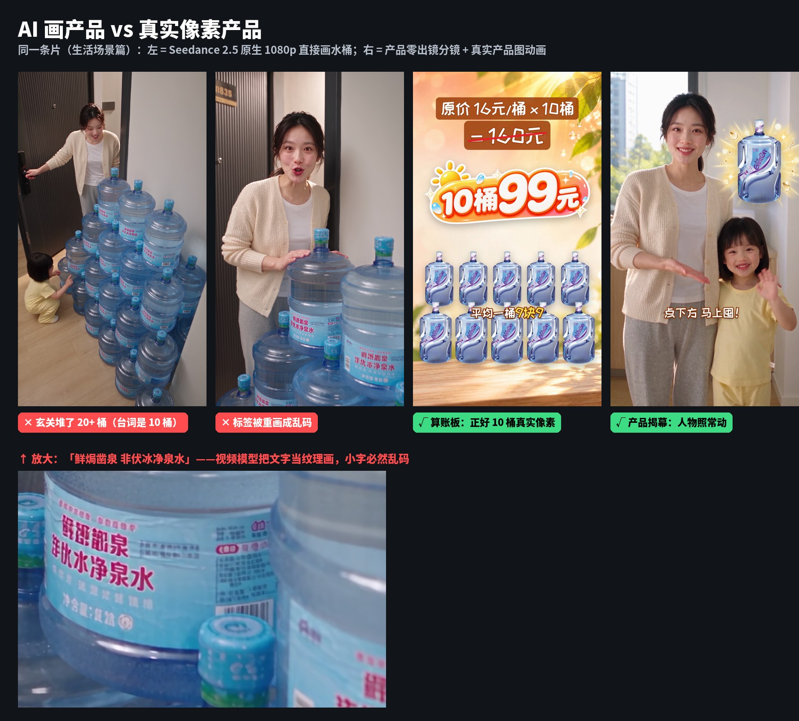
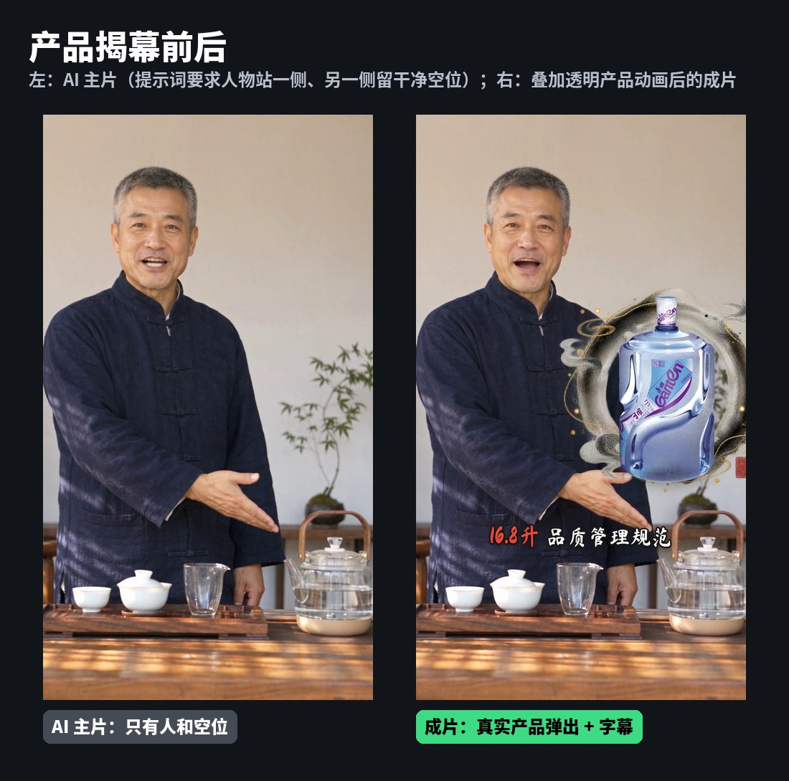
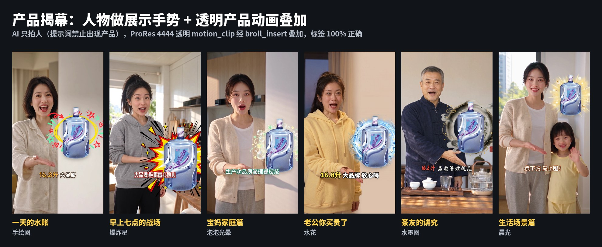
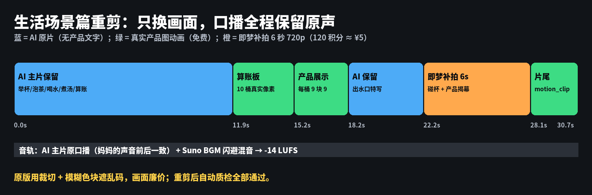
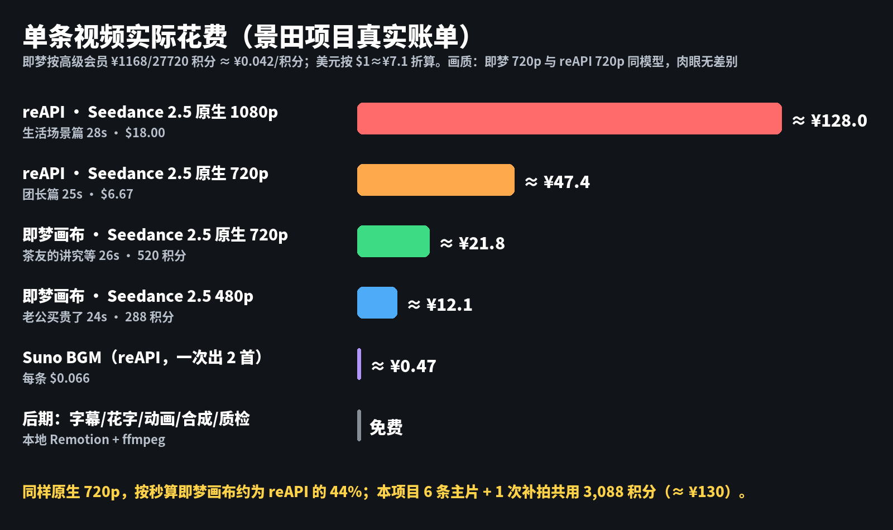
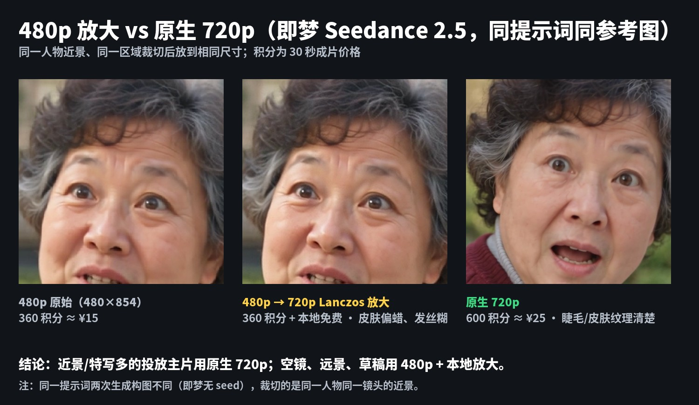
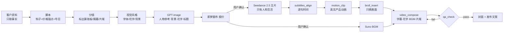

# AI 短视频带货 Skill · 产品零出镜工作流

**中文** | [English](README.en.md)

一套让 AI Agent（Claude Code / Codex / Kimi / Gemini 等）**端到端制作抖音 / 视频号 / TikTok 竖屏带货短视频**的 Skill + MCP 工具链：
从脚本、分镜、人物参考图、Seedance 2.5 视频生成，到字幕、花字、价格动画、BGM、封面、发布文案和自动质检。

它来自一个真实项目——给社区团购的桶装水做 **10 条 30 秒引流视频**——中所有的返工、踩坑和用户反馈。核心结论只有一句：

> **AI 只拍人和生活，产品画面全部用真实像素。**



视频模型会把标签画成乱码（上图：“饮用纯净水”变成“鲜焗凿泉 非伏冰净泉水”），会把台词里的“10 桶”画成 20 多桶。我们试过参考图模式、首帧模式、原生 1080p、AI 超分，问题都在。最后的办法是**在分镜阶段就把产品从 AI 画面里拿掉**，凡是要看到产品的地方，都用真实产品图做的动画盖上去，口播不中断。

---

## 目录

- [成果一览](#成果一览)
- [核心方法：产品零出镜分镜](#核心方法产品零出镜分镜)
- [实测数据](#实测数据)
- [工作流](#工作流)
- [快速开始](#快速开始)
- [仓库结构](#仓库结构)
- [经验清单（踩过的坑）](#经验清单踩过的坑)
- [常见问题](#常见问题)
- [许可](#许可)

---

## 成果一览

8 条成片的抖音封面——每条的人物、风格、字体、花字都是单独设计的：


同一个卖点（“原价 16×10=160 → 10 桶 99”），6 种完全不同的算账板动画：


| 指标 | 数值 |
|---|---|
| 成片 | 8 条，26.6–32.7 秒，720×1280 或 1080×1920 / 30fps，-14 LUFS |
| 字幕对齐 | 每条 14–19 句，100% 命中脚本 |
| 自动质检 | 8 条 0 fail；3 条有“大特写字幕靠近下巴”warn，人工确认不挡眼嘴 |
| 产品标签 | 100% 真实像素，0 处乱码 |
| 即梦单条成本 | 原生 720p 26 秒 520 积分 ≈ ¥22；480p 24 秒 288 积分 ≈ ¥12 |
| BGM | Suno，每条 $0.066（一次出 2 首选 1） |
| 后期 | 本地免费（Remotion + ffmpeg + Apple Vision 人脸检测） |

完整复盘：[docs/case-study.md](docs/case-study.md)。

## 核心方法：产品零出镜分镜

| 模块 | 做法 | 盖住哪句台词 |
|---|---|---|
| **算账板** | `motion_clip`：风格背景 + 文字逐行弹出 + 划线原价 + **10 个真实产品图逐个落下** + 价格花字，整画面替换 | “原价十六一桶，十桶一百六，现在十桶九十九” |
| **产品揭幕** | 提示词让人物站一侧、掌心向上做展示手势、另一侧留空；`motion_clip(transparent=True)` 输出带透明通道的光效 + 真实产品，**叠加**在人物镜头上 | “十六点八升，大品牌，喝着放心” |
| **片尾定版** | `motion_clip`：产品 + 价格 + 行动号召 + 合规小字 | 结尾 2.5 秒 |

插入时段取自 `subtitles_align` 对齐出的**实际口播时间**；`broll_insert` 只换画面、保留主片音轨，口播不断。



六种揭幕效果（手绘圈、爆炸星、泡泡、水花、水墨、晨光）：



已有成片也能用这套方法**重剪**：找回原始主片 → 有产品的镜头换成真实像素动画 → 只补拍最短的必要镜头（6 秒 = 120 积分）：



详见 [skill/douyin-video/reference/storyboard-product-zero.md](skill/douyin-video/reference/storyboard-product-zero.md)。

## 实测数据

### 成本：即梦画布 CLI vs reAPI（同模型 Seedance 2.5）



| 渠道 · 规格 | 实际账单 | 每秒 | 折合人民币 |
|---|---|---|---|
| reAPI · 原生 1080p · 28s | $17.997 | $0.643 | ≈ ¥128 |
| reAPI · 原生 720p · 25s | $6.671 | $0.267 | ≈ ¥47 |
| 即梦画布 · 原生 720p · 26s | 520 积分 | 20 积分 | ≈ ¥22 |
| 即梦画布 · 480p · 24s | 288 积分 | 12 积分 | ≈ ¥12 |
| 即梦画布 · 原生 720p 补拍 · 6s | 120 积分 | 20 积分 | ≈ ¥5 |
| Suno BGM（reAPI） | $0.066 | — | ≈ ¥0.47 |

> 折算：即梦高级会员 ¥1168 / 27720 积分 ≈ ¥0.042/积分；$1 ≈ ¥7.1。价格为 2026-10 实测，以服务端报价为准。
> 同模型同分辨率，两个渠道画质肉眼无差别；按秒算即梦约为 reAPI 的 44%。

### 画质：480p 放大 vs 原生 720p



480p 本地放大到 720p 时，皮肤偏蜡、睫毛和发丝糊，远景可以接受；近景、特写多的投放主片建议**原生 720p**（每 26 秒多 208 积分 ≈ ¥8.7）。

### 质检：抖音 UI 禁区与字幕避让


`qa_check` 标出顶部 10%、底部 20%、右侧按钮栏三处 UI 禁区（红色），检查字幕/花字是否压到五官、阅读速度、响度、黑场与静音。字幕只放在下半屏（0.46–0.78），用 Apple Vision 逐句避开人脸。

## 工作流



每一步都有清单与模板，见 [skill/douyin-video/SKILL.md](skill/douyin-video/SKILL.md)。**任何扣费步骤（即梦积分、reAPI 美元）都必须先给用户看报价、得到同意。**

## 快速开始

### 只用方法论（不装工具）

把 [`skill/douyin-video/`](skill/douyin-video/) 目录复制到你的 Agent 技能目录（如 `~/.claude/skills/douyin-video`），或者直接阅读其中的 `SKILL.md` 和 `reference/`。脚本模板、Seedance 提示词模板、发布文案模板都在 `templates/`。没有 MCP 工具时，可以用剪映 / ffmpeg 按同样的分镜手工完成。

### 完整安装（macOS，Apple Silicon 推荐）

```bash
# 1 依赖
brew install uv ffmpeg node whisper-cpp
git clone https://github.com/6667084/ai-short-video-skill.git ~/ai-short-video-skill
cd ~/ai-short-video-skill && uv sync
cd compose && npm install && cd ..
swiftc -O tools/facebox.swift -o tools/facebox          # Apple Vision 人脸检测（字幕避脸）
mkdir -p ~/.local/share/whisper && curl -L -o ~/.local/share/whisper/ggml-large-v3-turbo-q5_0.bin \
  https://huggingface.co/ggerganov/whisper.cpp/resolve/main/ggml-large-v3-turbo-q5_0.bin   # 国内可换成 hf-mirror.com

# 2 配置（密钥只放 .env，chmod 600）
mkdir -p ~/.config/media-mcp
cp .env.example ~/.config/media-mcp/.env && chmod 600 ~/.config/media-mcp/.env   # 填入你的密钥
cp settings.example.json ~/.config/media-mcp/settings.json                       # 项目目录、代理

# 3 即梦画布 CLI（需即梦会员）：按 https://jimeng.jianying.com/ai-tool/install 安装后
dreamina-canvas auth login

# 4 注册到 Agent（Claude Code / Codex / Hermes / Kimi / Antigravity / ZCode，幂等、自动备份）
uv run python sync_agents.py --dry-run     # 先看会改什么
uv run python sync_agents.py               # 或 --print-json 输出标准 mcpServers 配置手动粘贴
```

然后对 Agent 说：

> 用 douyin-video 给「<你的产品>」项目做一条 30 秒内的抖音带货视频，先给脚本和报价

详细说明：[docs/setup.md](docs/setup.md)。

### 需要的账号

| 服务 | 用途 | 必需？ |
|---|---|---|
| 即梦会员（dreamina-canvas） | Seedance 2.5 视频生成（默认通道） | 二选一 |
| [reAPI](https://reapi.ai) | Seedance / Wan 视频兜底、Suno BGM、云超分 | 二选一；BGM 需要 |
| OpenAI 兼容的图像接口（gpt-image） | 人物参考图、背景、花字、标题美术字 | 是 |
| 腾讯云 COS | 把本地参考素材转成 URL 提交给 reAPI | 仅 reAPI 需要 |

## 仓库结构

| 路径 | 内容 |
|---|---|
| `skill/douyin-video/SKILL.md` | 技能入口：铁律、13 步工作流、产品零出镜、渠道与分辨率、交付标准 |
| `skill/douyin-video/reference/` | 脚本与钩子、分镜、提示词、视觉风格、字幕排版、封面发布、即梦画布、模型价格、放大、踩坑记录 |
| `skill/douyin-video/templates/` | 脚本、Seedance 提示词、发布文案、成片工程、项目使用说明模板 |
| `skill/douyin-video/scripts/make_cover.py` | 封面合成（取帧 + 透明标题，3:4 安全区） |
| `servers/` | 7 个 MCP 服务：media-jimeng / media-reapi / media-image / media-edit / media-speech / cos-storage / almanac |
| `ms/` | 共用实现：即梦画布封装、reAPI 报价单、Remotion 合成与人脸感知排版、QA、字幕对齐、动画 |
| `compose/` | Remotion 工程（字幕、花字、动画渲染）与 6 款 OFL 中文字体 |
| `templates/douyin-ad.json` | 成片版式模板 |
| `docs/` | 案例复盘、安装说明、对比图 |

## 经验清单（踩过的坑）

| 症状 | 根因 | 做法 |
|---|---|---|
| 标签小字乱码 | 视频模型把文字当纹理画 | 产品零出镜，真实像素动画 |
| 台词说 10 桶，画面 20+ 桶 | 数量是模型弱项 | 算账板里放 10 个真实产品图层 |
| 片头大标题盖住人物 | 标题叠在视频上 | 标题只做封面 |
| 片内 “AI 生成” 角标多余 | 平台发布时会标注 | 画面不加，发布时勾选 |
| 产品合成进假场景很出戏 | 透视、光影、接地都不对 | 改“产品揭幕”叠加 |
| 人物没情绪 | 参考图是中性证件照 | 参考图按角色主情绪生成 |
| 结尾号召被模型吞掉 | 最后一句最容易丢 | 提示词强调必须说完；花字 + 片尾补 |
| 棕色字幕在暗场景看不清 | 配色 | 白字 + 主色深描边 |
| 字幕被推到额头 | 避脸算法候选太宽 | 字幕限定下半屏 0.46–0.78 |
| “透明”贴纸带白底 | 生图模型没给 alpha | 工具返回 warning，重生成 |
| 即梦 `login fail` | 走了代理 | 即梦必须直连 |
| 即梦 60fps 封装超分后时长变长 | 实际 24fps | `-fps_mode passthrough` 拆帧 |
| 用裁切、模糊补救乱码，画面廉价 | 事后补救 | 找回原片重剪 + 最短补拍 |

完整记录：[skill/douyin-video/reference/lessons-learned.md](skill/douyin-video/reference/lessons-learned.md)。

## 常见问题

**Q：不用这些工具，方法还有用吗？**
有用。产品零出镜、算账板、产品揭幕、标题只做封面、每条单独设计风格，这些都和工具无关，剪映里一样能做。

**Q：为什么不直接用图生视频（首帧放真实产品）？**
实测首帧模式第 0 帧的小字就已被重画；运动中标签还会漂移。必须一字不错的画面只能靠真实像素。

**Q：480p 够不够？**
远景、空镜够；人脸近景多的投放片建议原生 720p。见上面的对比图。

**Q：Agent 会不会乱花钱？**
所有付费工具都是“报价单 → 用户确认 → 提交”两步：即梦以服务端报价为积分上限，超出会被拒绝；submitId 先落盘，重试不重复扣费。Skill 的铁律也要求先给用户看报价。

**Q：能用于其他品类吗？**
可以。把提示词“道具禁忌”里的桶装水换成你的产品及其载体（瓶子、袋子、盒子、手机……），算账板与揭幕的做法不变。

## 许可

- 代码与文档：[MIT](LICENSE)。
- 字体（`compose/public/fonts`）：思源黑体、站酷快乐体、站酷庆科黄油体、站酷小薇、马善政、龙藏体，均为 SIL Open Font License 1.1。
- Remotion：个人与 ≤3 人公司免费，更大规模商用需购买许可（[remotion.dev/license](https://www.remotion.dev/license)）。
- `docs/images/` 中的案例画面来自真实项目，产品图与品牌标识归各自权利人所有，仅用于说明方法，不在 MIT 授权范围内。画面中的人物均为 AI 生成。
- 即梦、reAPI、OpenAI 等第三方服务的使用须遵守其各自条款。
